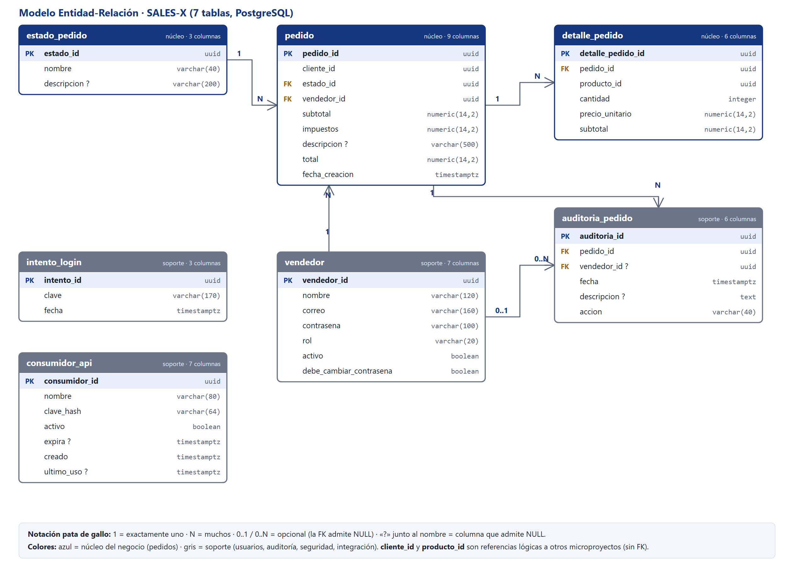

# 1. Introducción

Este documento describe cómo se organiza y almacena la información que necesita SALES-X. Responde a la pregunta guía de la evidencia: **¿cómo vamos a organizar y almacenar la información que necesita nuestra aplicación?**

El modelo no es teórico: se ha extraído de las tablas del programa. Las entidades, las columnas, las claves y las restricciones son exactamente las que crean `sql/01_schema.sql` y el modelo `app/models.py` (y que PostgreSQL ejecutó en las pruebas), de modo que este MER, el diccionario de datos (Evidencia 2) y la implementación no pueden contradecirse. El diagrama se genera con `python scripts/generar_mer.py` y el diccionario con `python scripts/generar_diccionario.py`; ambos fallan si el modelo cambia y no se documenta.

> **Criterio de diseño aplicado.** No se ha creado ninguna entidad «para llenar el diagrama». Cada tabla responde a una necesidad concreta del negocio y se puede rastrear hasta un requisito funcional (ver la matriz de trazabilidad, Evidencia 6).

# 2. Entidades

El sistema tiene **7 tablas**. Se distinguen dos grupos:

- **Núcleo del negocio** (azul oscuro): el ciclo de venta — `pedido`, `detalle_pedido` y `estado_pedido`.
- **Soporte** (gris): lo que hace funcionar ese ciclo con seguridad y trazabilidad — `vendedor`, `auditoria_pedido`, `intento_login` y `consumidor_api`.

| Entidad | Qué representa | Cols. | Grupo | Claves foráneas | Justificación en el sistema |
|---|---|---:|---|---|---|
| `estado_pedido` | Estados del pedido | 3 | núcleo | — | Catálogo cerrado: impide estados inventados y sustenta la máquina de estados (RF-08). |
| `pedido` | Cabecera de la venta | 9 | núcleo | `estado_id`, `vendedor_id` | Entidad central: registra a quién se vende, quién lo hizo y cuánto suma (RF-01, RF-07). |
| `detalle_pedido` | Líneas del pedido | 6 | núcleo | `pedido_id` | Resuelve el N:M entre pedidos y productos y **congela el precio** aplicado (RF-03). |
| `vendedor` | Usuarios internos | 7 | soporte | — | Autenticación, roles y autoría de cada operación (RNF-04, RF-13). |
| `auditoria_pedido` | Bitácora de operaciones | 6 | soporte | `pedido_id`, `vendedor_id` | Trazabilidad de solo-agregar: nada ocurre sobre un pedido sin dejar rastro (RNF-05). |
| `intento_login` | Fallos de inicio de sesión | 3 | soporte | — | Bloqueo por fuerza bruta compartido entre instancias (RF-14). |
| `consumidor_api` | Sistemas consumidores | 7 | soporte | — | Una clave por sistema de INTEGRAX, revocable y con expiración (RF-15). |

### Por qué los importes se guardan y el saldo de otros sistemas se deriva

`subtotal`, `impuestos` y `total` **sí se almacenan** en `pedido`: son una fotografía de lo que se acordó con el cliente en ese momento. Si se recalcularan cada vez a partir del catálogo, un cambio de precio posterior alteraría ventas ya cerradas. Por eso la línea guarda el `precio_unitario` y el pedido guarda sus totales, y el servidor es el único que los calcula (regla de negocio RN-02).

# 3. Diagrama entidad-relación

Notación pata de gallo (*crow's foot*). Las claves primarias aparecen resaltadas y marcadas con **PK**; las foráneas, con **FK**; las columnas que admiten NULL llevan un «?».



*Figura 1. Modelo entidad-relación de SALES-X (versión 1.2). `cliente_id` y `producto_id` son referencias lógicas a otros microproyectos y no son claves foráneas.*

> El modelo de datos aprobado en el seguimiento 2 (`docs/diagramas/modelo-de-datos.png`) contenía las cinco primeras tablas. Las dos de soporte — `intento_login` y `consumidor_api` — y la columna `vendedor.debe_cambiar_contrasena` se agregaron en la versión 1.1 por hallazgos de seguridad (H-04, H-06 y H-07); no alteran el modelo de negocio.

# 4. Relaciones y cardinalidades

| Relación | Cardinalidad | Regla que impone |
|---|---|---|
| `estado_pedido` **1** — **N** `pedido` | Un estado clasifica muchos pedidos | Todo pedido tiene exactamente un estado. |
| `vendedor` **1** — **N** `pedido` | Un vendedor registra muchos pedidos | `pedido.vendedor_id` es obligatorio. |
| `pedido` **1** — **N** `detalle_pedido` | Un pedido tiene una o más líneas | Mínimo 1 línea (lo exige la API); borrado en cascada. |
| `pedido` **1** — **N** `auditoria_pedido` | Un pedido acumula muchos eventos | Borrado en cascada; la aplicación nunca actualiza ni borra auditoría. |
| `vendedor` **0..1** — **0..N** `auditoria_pedido` | Un usuario genera muchos eventos | **Opcional:** `NULL` = acción de un sistema o cliente externo. |

## 4.1 Relaciones que no se deducen solo de la clave foránea

Hay vínculos que el diagrama no dibuja como línea porque no existe una FK, pero que son parte del diseño:

- **`pedido.cliente_id` → Clientes (otro microproyecto).** Es un identificador común de INTEGRAX. No hay FK porque esa tabla vive en otra base de datos; SALES-X valida que el cliente exista consumiendo el servicio REST de Clientes (o el catálogo simulado).
- **`detalle_pedido.producto_id` → Productos (otro microproyecto).** Ídem: se valida existencia, estado activo y disponibilidad al registrar o modificar el pedido, y el precio se toma de ese servicio.
- **`auditoria_pedido` ↔ `vendedor` opcional.** Las solicitudes de modificación o cancelación que llegan del cliente (CU-05) no tienen un usuario interno, por eso la FK admite NULL; el nombre que se muestra es «Sistema externo».
- **La máquina de estados** no es una relación sino una regla del servicio (`app/services/pedidos.py`):

```
Pendiente → Confirmado → En preparación → Enviado → Entregado
    │            │              │
    └────────────┴──────────────┴──→ Cancelado
```

*Entregado* y *Cancelado* son estados finales; solo se puede modificar un pedido en *Pendiente* o *Confirmado*.

# 5. Claves y restricciones

Los valores válidos viven **en la base de datos**, no solo en la interfaz: aunque alguien llame a la API directamente o escriba SQL, la base rechaza lo inválido.

## 5.1 Restricciones CHECK: los valores válidos viven en la base

| Tabla | Restricción | Valores permitidos |
|---|---|---|
| `vendedor` | `ck_vendedor_rol` | `rol` ∈ {`admin`, `vendedor`} |
| `pedido` | `ck_pedido_total` | `total` ≥ 0 |
| `detalle_pedido` | `ck_detalle_cantidad` | `cantidad` > 0 |
| `detalle_pedido` | `ck_detalle_precio` | `precio_unitario` ≥ 0 |

## 5.2 Restricciones UNIQUE: qué no puede repetirse

| Tabla | Columna | Restricción |
|---|---|---|
| `vendedor` | `correo` | No hay dos usuarios con el mismo correo. |
| `estado_pedido` | `nombre` | No hay dos estados con el mismo nombre. |
| `consumidor_api` | `nombre` | No hay dos consumidores con el mismo nombre. |
| `consumidor_api` | `clave_hash` | No hay dos consumidores con la misma clave. |

## 5.3 Índices: para qué sirven

| Índice | Columna(s) | Consulta que acelera |
|---|---|---|
| `ix_pedido_cliente` | `pedido.cliente_id` | Historial de un cliente (RF-09). |
| `ix_pedido_fecha` | `pedido.fecha_creacion` | Reportes por rango de fechas (RF-10). |
| `ix_pedido_estado` | `pedido.estado_id` | Filtro por estado (RF-06). |
| `ix_detalle_pedido` | `detalle_pedido.pedido_id` | Líneas de un pedido. |
| `ix_auditoria_pedido` | `auditoria_pedido.pedido_id` | Auditoría de un pedido. |
| `ix_intento_login_clave` / `_fecha` | `intento_login.clave`, `.fecha` | Contar fallos recientes de una cuenta. |

## 5.4 Reglas de integridad de los importes

- `subtotal = Σ detalle.subtotal`; `impuestos = subtotal × IVA`; `total = subtotal + impuestos` (redondeo half-up a 2 decimales). Los calcula solo el servidor.
- Dinero en `NUMERIC(14,2)` y fechas en `TIMESTAMPTZ` (UTC): evitan errores de redondeo de coma flotante y ambigüedad de zonas horarias.
- Dentro de un pedido no se repite `producto_id`: las líneas repetidas se consolidan sumando cantidades.
