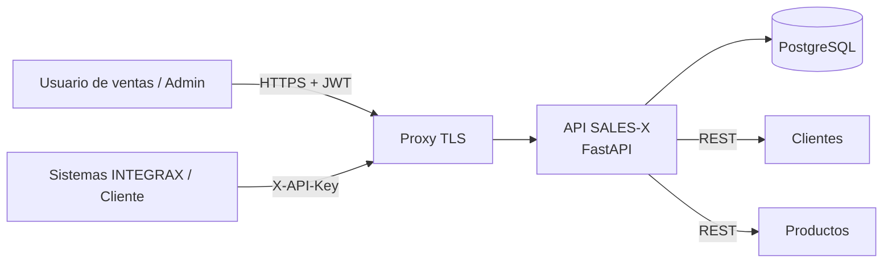
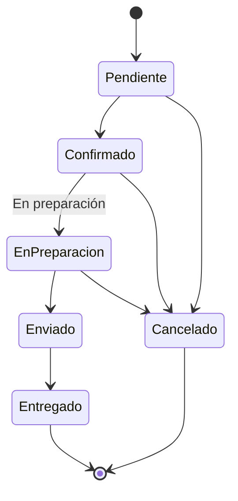
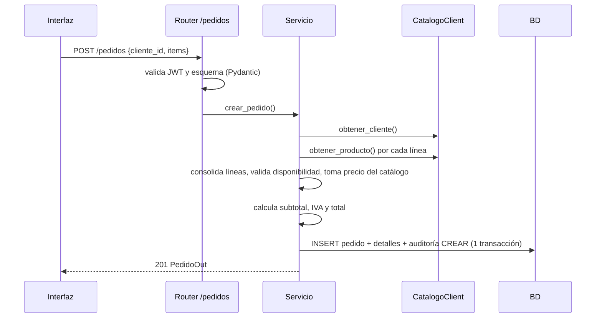

# Diseño — SALES-X · Gestión de Ventas y Pedidos

**Versión:** 1.0 · Implementa los requisitos de `requirements.md`. Detalle formal en `docs/E1`, `docs/E2` y `docs/Guia-de-Operacion-y-Despliegue.md`.

## 1. Visión general

SALES-X es una **API REST sin estado** (FastAPI) con una interfaz web estática servida por la misma aplicación, base de datos propia y una capa de integración hacia Clientes y Productos de INTEGRAX.

### Capas y responsabilidades
| Capa | Archivos | Responsabilidad | Reglas |
|---|---|---|---|
| Presentación | `app/static/` | Interfaz web (JS puro, sin librerías) | No contiene reglas de negocio críticas; el servidor valida todo. |
| API / rutas | `app/routers/` | HTTP, validación de entrada, autorización | Delgadas: delegan en servicios. |
| Servicios | `app/services/pedidos.py` | Reglas de negocio, máquina de estados, auditoría | Única capa que modifica pedidos. |
| Integración | `app/integration/catalogo.py` | Puerto `CatalogoClient` con proveedores `simulado` y `rest` | La capa de negocio no sabe de dónde vienen los datos. |
| Datos | `app/models.py`, `app/database.py` | ORM SQLAlchemy | Consultas parametrizadas. |
| Transversal | `security.py`, `deps.py`, `config.py`, `timeutil.py` | Autenticación, configuración, zona horaria | — |

## 2. Modelo de datos
Cinco tablas: `estado_pedido`, `vendedor`, `pedido`, `detalle_pedido`, `auditoria_pedido` (ver `docs/E1` y `docs/E2`, y `sql/01_schema.sql`).

| Decisión | Motivo |
|---|---|
| `cliente_id` y `producto_id` sin clave foránea | Pertenecen a otros microproyectos con BD propia. |
| Dinero en `NUMERIC(14,2)`; fechas en `TIMESTAMPTZ` (UTC) | Evitar errores de redondeo y de zona horaria. |
| `detalle_pedido.precio_unitario` se guarda | Conserva el precio histórico aunque el catálogo cambie. |
| `auditoria_pedido.vendedor_id` admite `NULL` | Las solicitudes externas (REQ-12) no tienen usuario interno. |

## 3. Máquina de estados (REQ-08)

Implementada como el diccionario `TRANSICIONES` en `app/services/pedidos.py`; la modificación solo se permite en `MODIFICABLES = {Pendiente, Confirmado}`.

## 4. Flujo principal: registrar un pedido (REQ-01…03, 07)

## 5. Contrato de la API (`/api/v1`)

| Grupo | Endpoint | Requisito |
|---|---|---|
| Auth | `POST /auth/login` · `GET /auth/me` | REQ-NF-04 |
| Usuarios (admin) | `GET/POST /vendedores` · `PATCH /vendedores/{id}` | REQ-13 |
| Pedidos | `POST /pedidos` | REQ-01…03, 07 |
| | `GET /pedidos` · `GET /pedidos/{id}` | REQ-06 |
| | `PUT /pedidos/{id}` | REQ-04 |
| | `POST /pedidos/{id}/cancelar` | REQ-05 |
| | `PATCH /pedidos/{id}/estado` · `GET /estados` | REQ-08 |
| | `GET /pedidos/historial/{cliente_id}` | REQ-09 |
| | `GET /pedidos/{id}/auditoria` · `GET /pedidos/solicitudes` | REQ-NF-05, REQ-12 |
| Catálogo | `GET /catalogo/clientes` · `/catalogo/productos` · `/catalogo/productos/{id}/disponibilidad` | REQ-11 |
| Reportes | `GET /reportes/ventas` · `GET /reportes/ventas.csv` | REQ-10 |
| Integración | `GET /integracion/pedidos/{id}` · `/integracion/clientes/{id}/pedidos` · `/integracion/disponibilidad/{id}` · `POST /integracion/pedidos/{id}/solicitudes` | REQ-12 |
| Operación | `GET /health` | REQ-NF-03 |

Las rutas fijas (`/pedidos/historial/…`, `/pedidos/solicitudes`) se declaran **antes** de `/pedidos/{pedido_id}` para que no se interpreten como UUID.

## 6. Manejo de errores

| Código | Cuándo |
|---|---|
| 401 | Sin credenciales, token inválido/expirado, usuario inactivo, API Key incorrecta. |
| 403 | Rol insuficiente. |
| 404 | Pedido o producto inexistente. |
| 409 | Regla de negocio violada: estado inválido, disponibilidad insuficiente, duplicados. |
| 422 | Entrada inválida (Pydantic) o referencia inexistente (cliente/producto/estado). |
| 429 | Bloqueo por intentos de login fallidos. |
| 502 | Servicio externo de INTEGRAX no disponible (no se registra el pedido). |
| 500 | Error no controlado: se registra con traza y el cliente solo ve un mensaje genérico. |
| 503 | `/health` con la base de datos caída. |

## 7. Seguridad (REQ-NF-04, 09, 10)
- **Autenticación:** JWT HS256 (8 h) para usuarios; `X-API-Key` comparada en tiempo constante para sistemas. Contraseñas con bcrypt (costo 12) y verificación con hash ficticio para igualar tiempos.
- **Autorización:** roles `admin`/`vendedor` mediante dependencias de FastAPI.
- **Entrada/salida:** esquemas Pydantic estrictos; ORM parametrizado; el servidor ignora precios y totales enviados por el cliente; la interfaz escapa todo dato dinámico.
- **Cabeceras:** `nosniff`, `X-Frame-Options: DENY`, `Referrer-Policy`, **CSP** `default-src 'self'` y HSTS en producción.
- **Configuración:** en `production` valida secretos, base de datos y usuarios demo al arrancar.
- **Auditoría:** tabla de solo-agregar; el rol `salesx_app` (`sql/03`) refuerza la inmutabilidad a nivel de BD.

### 7.0 Concurrencia (v1.2)

Las operaciones que cambian un pedido (modificar, cambiar de estado, cancelar) lo cargan con `SELECT … FOR UPDATE` (`obtener_pedido(bloquear=True)`, con `lazyload` del estado para que la relación se lea tras obtener el bloqueo). Así dos peticiones simultáneas sobre el mismo pedido se serializan y la segunda ve el estado ya cambiado (409). En SQLite el bloqueo no existe (solo demostración). *Origen:* hallazgo H-14 / DEF-07.

### 7.1 Endurecimiento v1.1 (REQ-14…17)
| Tema | Diseño |
|---|---|
| Bloqueo de login | Tabla `intento_login (clave, fecha)`; consulta de fallos en los últimos 5 min. Compartido entre réplicas y reinicios. Servicio `app/services/login_throttle.py`. |
| Claves de integración | Tabla `consumidor_api (nombre, clave_hash SHA-256, activo, expira, ultimo_uso)`. Claves de alta entropía (`sx_` + 32 bytes aleatorios), por lo que basta un hash rápido. El consumidor inicial se crea desde `INTEGRATION_API_KEY`. Admin: `/consumidores`. |
| Sesión | `POST /auth/login` fija `salesx_session` (`HttpOnly`, `SameSite=Strict`, `Secure` en producción) y `salesx_csrf` (legible). `current_user` acepta `Authorization: Bearer` (sin CSRF) o la cookie (CSRF *double-submit*: cabecera `X-CSRF-Token` = cookie). `POST /auth/logout` borra ambas. |
| Contraseñas | Política en `security.validar_contrasena`; columna `vendedor.debe_cambiar_contrasena`. `session_user` (sin bloqueo) para `/auth/me`, `/auth/cambiar-contrasena`, `/auth/logout`; `current_user` (con bloqueo 403) para el resto. |
| Migración | `sql/04_migracion_v1_1.sql` (idempotente) para bases creadas con la v1.0. |
| Rol de BD | La API se conecta como `salesx_app` (`sql/03_rol_aplicacion.sql`): lee y escribe datos, **no** crea ni altera objetos, y en `auditoria_pedido` solo puede `SELECT`/`INSERT`. El dueño (`salesx`) solo aplica esquema y migraciones. **Sin permisos por defecto** sobre tablas futuras (falla cerrada): una tabla nueva requiere reejecutar el script (o un `GRANT` en la migración); restaurar un respaldo con `--clean` reproduce los permisos del respaldo (DEF-03). En `docker-compose` lo crea `docker/03_aplicar_rol_app.sh`. |

## 8. Integración con INTEGRAX
Puerto `CatalogoClient` con dos proveedores seleccionados por `CATALOGO_PROVIDER`:
- `simulado` (por defecto): 5 clientes y 10 productos de demostración, con UUID deterministas.
- `rest`: consume `CLIENTES_API_URL` y `PRODUCTOS_API_URL` con tiempo de espera de 5 s. Un cliente HTTP **persistente** reutiliza conexiones (≈ 1 ms por consulta). Cualquier fallo del servicio —caído, lento, error HTTP, no-JSON o respuesta que no cumple el contrato— se traduce en **502** y el pedido no se registra. Las URLs vienen solo de configuración (sin riesgo de SSRF). Verificado contra `mocks/integrax_mock.py` (pruebas y `docker-compose.mock.yml`); **no** contra los servicios reales.

## 9. Zona horaria (REQ-06, REQ-10)
Se almacena en UTC; filtros y agrupaciones se interpretan en `BUSINESS_TZ` (America/Bogota) mediante `app/timeutil.py`. *Origen:* defecto DEF-01 (reportes vacíos para pedidos nocturnos).

## 10. Estrategia de pruebas
| Nivel | Qué | Dónde |
|---|---|---|
| Integración de API | 27 pruebas sobre HTTP real (cliente de FastAPI) con BD limpia | `tests/test_api.py` |
| Concurrencia (v1.2) | 3 pruebas × 30 rondas con hilos: una sola de dos operaciones simultáneas prospera y la cadena de estados es válida (solo PostgreSQL) | `tests/test_concurrencia.py` |
| Endurecimiento v1.1 | 15 pruebas: bloqueo en BD, consumidores, cookie+CSRF, contraseñas | `tests/test_endurecimiento.py` |
| Integración REST | 14 pruebas contra un servicio HTTP simulado: éxito, 404, caída, 500, timeout, respuestas inválidas, flujo completo | `tests/test_catalogo_rest.py`, `mocks/integrax_mock.py` |
| Configuración | Validación de producción | `tests/test_config.py` |
| Zona horaria | Rangos diarios y conversión | `tests/test_timeutil.py` |
| Motores | Misma suite en SQLite (por defecto) y PostgreSQL (`TEST_DATABASE_URL`, base `*_test`) | `tests/conftest.py` |
| Esquema SQL | Suite sobre esquema creado con `sql/01`+`02` (`TEST_KEEP_SCHEMA=1`) | manual |
| Carga | 500–1 000 peticiones concurrentes | `scripts/carga_basica.py` |
| Dependencias | `pip-audit` | manual |

## 11. Decisiones de diseño (ADR resumidas)
| # | Decisión | Alternativas descartadas | Consecuencia |
|---|---|---|---|
| D-01 | FastAPI + SQLAlchemy | Django REST, Flask | OpenAPI automático; validación con Pydantic. |
| D-02 | SQLite como respaldo de desarrollo | Exigir PostgreSQL siempre | Arranque en un clic; suite en ambos motores para evitar divergencias. |
| D-03 | Interfaz en JS puro, servida por la API | React/Vue con Node | Sin cadena de build ni dependencias externas; CSP estricta. |
| D-04 | Precio y totales calculados en servidor | Confiar en el cliente | Elimina manipulación de importes. |
| D-05 | Solicitudes del cliente solo se auditan | Aplicarlas automáticamente | Ventas decide; el pedido no cambia sin un usuario. |
| D-06 | Catálogo detrás de un puerto con proveedor simulado | Acoplar a servicios inexistentes | Se puede avanzar sin los otros microproyectos; cambio a REST por configuración. |
| D-07 | Contadores de login en la BD *(v1.1; antes en memoria)* | Redis; memoria del proceso | Compartido entre instancias sin añadir infraestructura; cada intento fallido cuesta una escritura. |
| D-08 | Sesión en cookie `HttpOnly` + CSRF *double-submit*, y Bearer para clientes de API | Solo Bearer en `sessionStorage` | El JavaScript no puede leer la sesión; los clientes de API no necesitan CSRF. |
| D-09 | Una clave por consumidor, guardada como SHA-256 | Clave única; bcrypt | Revocable y trazable; las claves de 256 bits no necesitan un hash lento. |

## 12. Riesgos y limitaciones conocidas
Ver `docs/01-Informe-Auditoria-Seguridad-SALES-X.md` (13 hallazgos; 7 remediados, 5 abiertos) y `docs/05-Revision-Lanzamiento-GO-NO-GO.md`. Los reportes se calculan en memoria sobre el rango pedido (ver `docs/capacidad.md` §4).
